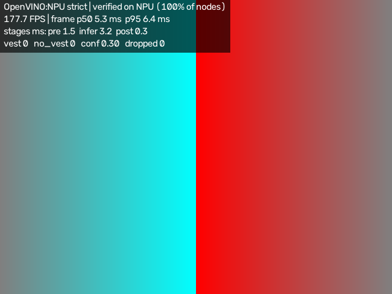

# PPE vest detector

On-device detection of hi-vis vests (`vest` / `no_vest`) with ONNX Runtime, built so that
**"runs on the NPU" is something you can verify, not something you assume.**

> **Beta (v0.1).** The model does not meet the project's 95% precision / recall target. Measured
> numbers and their uncertainty are below and in the [model card](docs/MODEL_CARD.md). It is a
> screening aid for a human reviewer, not a safety system.



*`ppe window` on an Intel Core Ultra 7 256V, INT8 model, strict NPU mode, built-in synthetic source
(self-test mode runs unpaced, hence the high FPS). The first HUD line is a measurement: node placement
is profiled in the background.*

## What it does

- **Detects** worn and missing hi-vis vests per frame, from a camera, video or image.
- **Proves placement.** ONNX Runtime silently runs unsupported operators (or a provider that failed to
  load) on the CPU. `--strict-npu` forbids that, and `ppe verify-npu` profiles a run and reports which
  provider executed every node.
- **Measures itself.** Per-stage latency (preprocess / inference / decode), percentiles, and a
  reproducibility fingerprint (runtime versions, NPU driver, model hash) in every result file.
- **Installs without torch.** The runtime needs numpy, OpenCV and one ONNX Runtime build.

It does **not** tell you which worker is missing a vest: the model has no `person` class, so results
are per frame (boxes and counts). See [Limitations](#limitations).

## Quick start (Intel NPU, Windows)

```powershell
python -m venv .venv; .venv\Scripts\Activate.ps1
python -m pip install "ppe[npu,gui] @ git+https://github.com/A-Kuo/Worker-Safety-PPE-Detection-Model@v0.1.0"
ppe fetch-model                       # verified download of the vest model
ppe verify-npu --providers openvino   # exit 0 only if every node ran on the NPU
ppe window --strict-npu --providers openvino
```

From a checkout, replace the install line with `python -m pip install -e ".[npu,gui]"`.

No NPU? Use the CPU build: `pip install "ppe[cpu,gui] @ git+…"`, then `ppe fetch-model` and
`ppe window`. No camera? `ppe window --source clip.mp4`, an image path, or `--source synthetic`.

### Install options

Pick **exactly one** runtime; the two share the `onnxruntime` import and must not be installed together.

| Extra | Installs | For |
|---|---|---|
| `cpu` | `onnxruntime` | Any machine |
| `npu` | `onnxruntime-openvino` + `openvino` | Intel NPU / iGPU (Lunar Lake and similar) |
| `gui` | PySide6 | The live window |
| `quant` | `onnx`, `onnxconverter-common` | `ppe quantize` |
| `train` | torch, ultralytics, roboflow | Training, evaluation scripts, `ppe export` |
| `app` | FastAPI, Streamlit | The older browser demo under `app/` |
| `dev` | pytest, onnx, build, twine | Tests and packaging |

Python 3.10 – 3.12.

## Commands

| Command | What it does |
|---|---|
| `ppe fetch-model [--list]` | Download a released model; installed only if size and SHA-256 match |
| `ppe verify-npu` | Profile a run and report the provider of every node (`--soft` lists CPU-resident ops) |
| `ppe window` | Live window with HUD. Space pause, R record, +/- threshold, A about, Q quit |
| `ppe predict --source img.jpg` | One image: boxes, per-class counts |
| `ppe bench` | Latency percentiles and stage breakdown, with fingerprint |
| `ppe eval --images dir` | Accuracy on a labeled folder: box counts, AP50, Wilson intervals |
| `ppe quantize` / `ppe export` | Build INT8 / ONNX models (`quant` / `train` extras) |
| `ppe providers` | Execution providers available on this machine |

Useful flags: `--strict-npu` (no CPU provider, no CPU fallback, static shapes, device pinned to the
NPU), `--providers openvino`, `--openvino-device NPU|GPU|CPU`, `--conf`. Details:
[docs/edge_npu.md](docs/edge_npu.md).

## Accuracy

The shipped FP32 ONNX, scored through this package's runtime on the NPU in strict mode. Test set: 145
images deduplicated against the training data, **249 `vest` boxes and 43 `no_vest` boxes**. Confidence
0.30, Wilson 95% intervals.

| Class | Boxes | AP50 | Precision (95% CI) | Recall (95% CI) |
|---|---|---|---|---|
| vest | 249 | 0.916 | 0.897 (0.853 – 0.930) | 0.879 (0.833 – 0.914) |
| no_vest | 43 | 0.711 | 0.648 (0.515 – 0.762) | 0.814 (0.674 – 0.903) |

- **The 95% target is not met**, and the intervals lie entirely below it, so this is not sampling noise.
- **43 `no_vest` boxes is a small sample.** The recall interval is 23 points wide.
- `no_vest` precision of about 0.65 means roughly one false alarm in three at this threshold.

Full tables, the operating-point trade-off, and how the numbers tie back to the training run are in
the [model card](docs/MODEL_CARD.md). Every number there is regenerated from committed result files by
`scripts/summarize_evidence.py`.

## Latency

Intel Core Ultra 7 256V (NPU "Intel AI Boost", Arc 140V iGPU), `onnxruntime-openvino` 1.24.1, OpenVINO
2025.4.1. End to end per frame (preprocess + inference + decode), 300 iterations, min – max over runs.

| Model | Device | p50 ms | p95 ms |
|---|---|---|---|
| INT8 | NPU, strict | 4.25 – 4.31 | 5.55 – 5.68 |
| FP32 | iGPU | 5.09 – 5.47 | 6.14 – 6.45 |
| FP32 | NPU, strict | 6.23 – 6.41 | 7.41 – 9.04 |
| FP32 | CPU (OpenVINO) | 26.4 | 31.1 |

INT8 on the NPU is the fastest configuration measured; in FP32 the iGPU is faster than the NPU. One
non-isolated machine: tail latency varied between runs and is not a guarantee. Power draw was not
measured, so no efficiency claim is made.

## Limitations

- Beta accuracy, as above. Real-footage and cross-site evaluation have not been done.
- Frame-level only. Attaching vest status to individual workers needs a person detector (roadmap).
- Vests only. No helmets, goggles, gloves or boots in the shipped model.
- Verified on one Intel Lunar Lake machine. Other NPUs (Qualcomm QNN, Apple Core ML) are wired into
  the provider registry but untested.
- The training data is construction-site imagery with partial labels; expect weaker results elsewhere.

## Repository layout

```text
src/ppe/            runtime, CLI, live window, evaluation, model registry
scripts/            training / data pipeline (called by the Kaggle notebook), smoke and release checks
tests/              unit and integration tests (no dataset or NPU needed)
docs/               model card, NPU guide, experiments log, releasing
configs/            dataset and training configs
results/            committed evidence: accuracy, placement and latency JSON
notebooks/          Kaggle / Colab training notebook
app/                older FastAPI + Streamlit demo (source checkout only)
archive/            superseded tooling and notes kept for provenance
```

## Development

```bash
python -m pip install -e ".[cpu,dev]"
python -m pytest -q
python scripts/smoke_edge.py --require-npu     # generated model, no torch, no weights
python -m build && python scripts/wheel_smoke.py
```

CI runs the torch-free path on Ubuntu (Python 3.10 – 3.12) and Windows, including installing the built
wheel in a fresh environment. Training and the data pipeline are described in
[docs/experiments.md](docs/experiments.md) and [scripts/run_pipeline.md](scripts/run_pipeline.md);
releases in [docs/RELEASING.md](docs/RELEASING.md). See [CONTRIBUTING.md](CONTRIBUTING.md).

## Licence

Code and model weights: **GNU Affero General Public License v3.0 only** ([LICENSE](LICENSE)). The
detector is built with [Ultralytics](https://github.com/ultralytics/ultralytics) YOLOv8 (AGPL-3.0) and
the weights are a derivative of it. If you run a modified version as a network service you must offer
its source to the users of that service; the API, the web demo and the window's About dialog link to
the source for that reason.

Training data is from Roboflow Universe under CC BY 4.0. Credits and third-party notices:
[ATTRIBUTION.md](ATTRIBUTION.md), [NOTICE](NOTICE).
